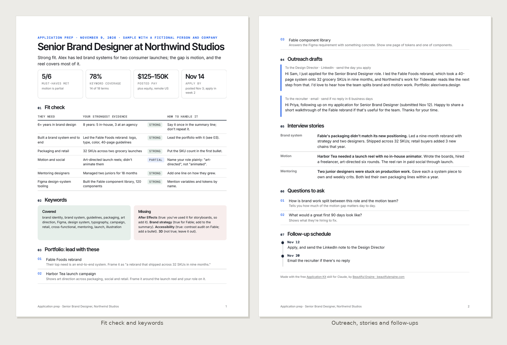
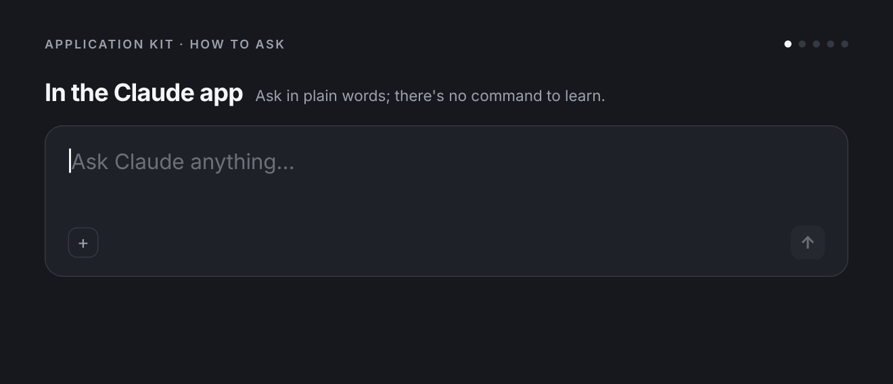

# Application Kit

Turn a job posting and a resume into everything needed to apply well: a resume and cover letter aimed at this role, a clear-eyed fit check, the portfolio pieces to lead with, notes to the people doing the hiring, and a follow-up plan. Everything comes from the person's real experience, said in the posting's language.

**What you get:** Builds a tailored job application from a job posting and a resume - a rewritten resume and cover letter as Word files and PDFs that applicant tracking systems can read, plus a prep sheet PDF with a requirement-by-requirement fit check, keyword coverage, which portfolio pieces to lead with, outreach notes to the recruiter and hiring manager, interview stories, questions to ask and a follow-up schedule. Never invents experience.



**See the full sample:** [Sample-Northwind-Application-Prep.pdf](examples/Sample-Northwind-Application-Prep.pdf) (fictional names and figures)

Made by Beautiful Engine · [beautifulengine.com](https://www.beautifulengine.com) · [Questions or ideas? Open an issue](https://github.com/BeautifulEngine/application-kit/issues/new)

## Install

### Claude app (web or desktop)

1. Download **[application-kit.zip](application-kit.zip)** from this repo (open the file, then use the download button). Don't unzip it.
2. Turn on **Settings > Capabilities > "Code execution and file creation"**.
3. Go to **Customize > Skills**, click **+**, then **+ Create skill > Upload a skill**, and upload the zip.
4. Start a new chat and ask in plain words. Claude picks the skill up on its own.

> GitHub's green "Code > Download ZIP" button won't work for this; it wraps everything in an extra folder. Use `application-kit.zip`.

### Claude Code

As part of the Beautiful Engine collection (you get updates and the other skills):

```bash
claude plugin marketplace add BeautifulEngine/skills
claude plugin install beautiful-engine@beautiful-engine
```

Then use `/beautiful-engine:application-kit`, or ask in plain words. Or install just this one:

```bash
git clone https://github.com/BeautifulEngine/application-kit.git
mkdir -p ~/.claude/skills && cp -r application-kit/application-kit ~/.claude/skills/
```

Then use `/application-kit`.

## Usage



```
/application-kit <job posting URL or pasted text> [company brief attached] [portfolio link]
```

Attach a resume (PDF, Word or text) or point to one from earlier in the conversation. Plain requests work too:

- "Tailor my resume and write a cover letter for this role: <link>." (resume attached)
- "Application kit for the Netflix Design Lead posting. Here's my resume and my Company Brief on Netflix."
- "Just the cover letter, warm and direct, for this posting."
- "Outreach note to the hiring manager for this role."
- Add "one page" or "two pages" to set resume length.

Works well after the Company Brief skill: if a brief on the company exists in the conversation or is attached, use its priorities, language, people and interview notes.

**Files.** `<skill-dir>` means this skill's folder, the one holding this SKILL.md. Templates are in `assets/`, scripts in `scripts/`, and the shared PDF steps (fonts, colors, render, check) are in `references/rendering.md`.

## When Claude uses it

Someone asks to tailor a resume, write a cover letter, apply for a job, prepare an application, or reach out about a role.

## How it works

```
application-kit/
├── SKILL.md
├── assets/  base.css, deck.css, kit-template.html, resume-template.html
├── scripts/  audit.js, contact_sheet.py, fonts.py, md_doc.py, render.cjs, render.py, tokens.py
├── references/  rendering.md
```

PDFs are built from HTML templates, colored and typeset with the right brand, rendered by headless Chrome, then checked for fonts, text contrast and leftover blanks before delivery. Anything with numbers in it is calculated by a script, not estimated.

## Works well with

- [Company Brief](https://github.com/BeautifulEngine/company-brief)
- [Case Study](https://github.com/BeautifulEngine/case-study)
- [All Beautiful Engine skills](https://github.com/BeautifulEngine/skills)

## Made by Beautiful Engine

Application Kit is made by [Beautiful Engine](https://www.beautifulengine.com), a creative studio in Los Angeles working across brand, experiential and interactive design.

- **Website:** [beautifulengine.com](https://www.beautifulengine.com)
- **Questions, ideas, or something broke?** [Open an issue](https://github.com/BeautifulEngine/application-kit/issues/new) and describe what you asked for and what happened.

This repo is published from [BeautifulEngine/skills](https://github.com/BeautifulEngine/skills); changes are made there and copied here.

## License

MIT. See [LICENSE](LICENSE).

